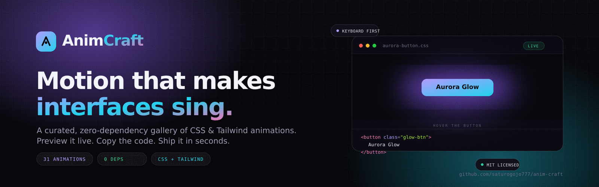
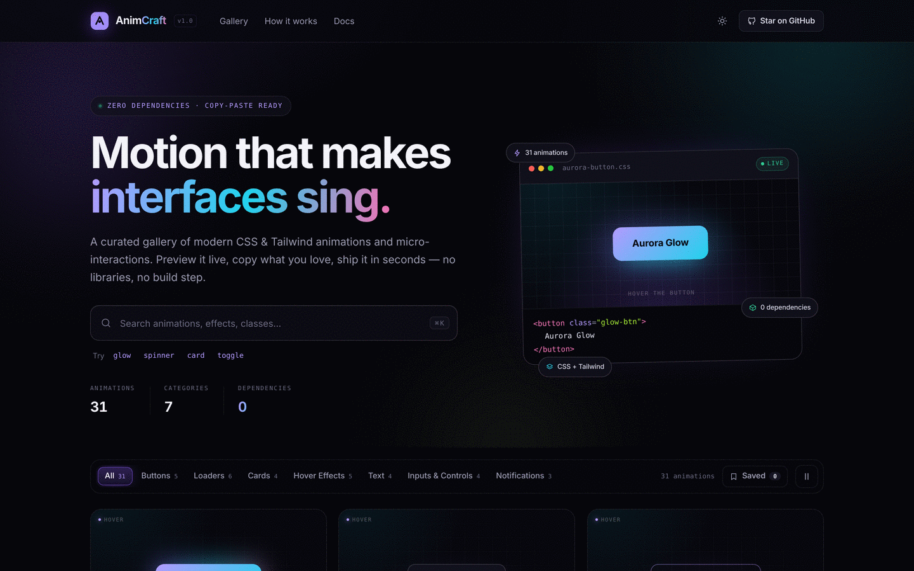
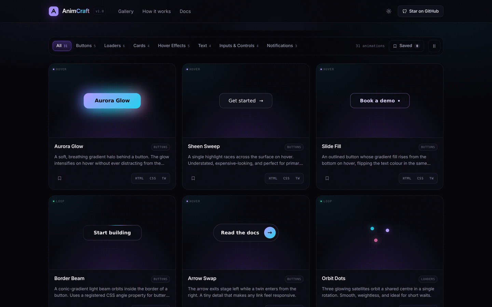
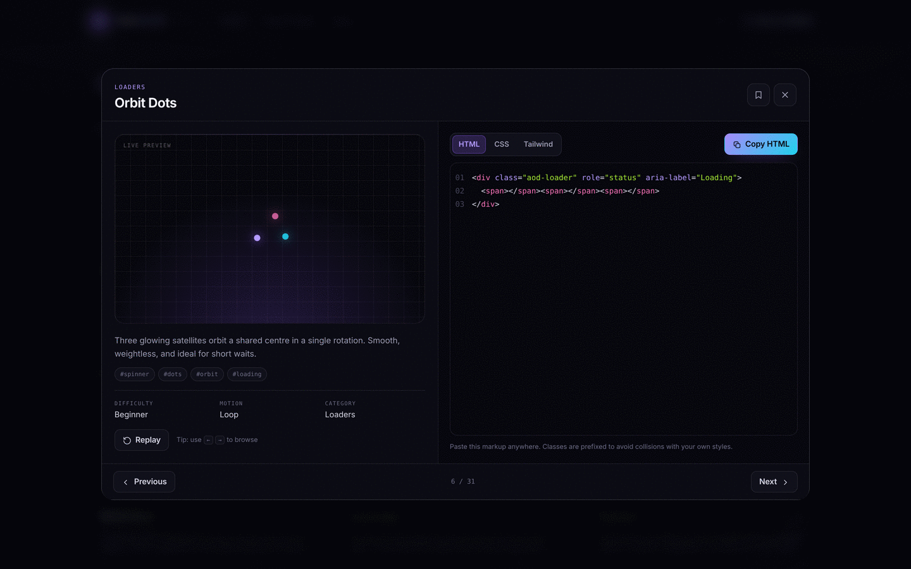
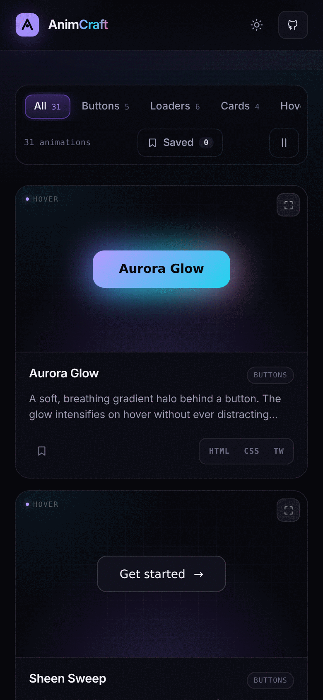

<div align="center">



# AnimCraft

**A curated, zero-dependency gallery of modern CSS & Tailwind animations and micro-interactions.**
Preview it live, copy the code, ship it in seconds.

[](LICENSE)
[](#-why-animcraft)
[](CONTRIBUTING.md)
[](#-project-structure)
[](#-deploy-to-github-pages)

**[Live demo](https://saturogojo777.github.io/anim-craft/)** · **[Browse the gallery](https://saturogojo777.github.io/anim-craft/#gallery)** · **[Report a bug](https://github.com/saturogojo777/anim-craft/issues/new?template=bug_report.yml)** · **[Request an animation](https://github.com/saturogojo777/anim-craft/issues/new?template=animation-request.yml)**

</div>

---

## ✨ Why AnimCraft?

Most animation libraries ask you to install a package, learn an API, and ship 40 kB of JavaScript you will never read. AnimCraft takes the opposite approach.

|  |  |
| :-- | :-- |
| **Zero dependencies** | No npm install, no runtime, no build step. Three files and a browser. |
| **Copy-paste native** | Every card gives you **HTML**, **vanilla CSS**, and **Tailwind** markup. One click each. |
| **Honest previews** | The gallery renders the *exact* CSS it hands you — the preview and the snippet share one source of truth. |
| **Accessible by default** | Keyboard-navigable filters, focus-visible rings, ARIA labels, and reduced-motion guidance on every snippet. |
| **Themeable** | One token file (`theme-vars.css`) drives both dark and light modes — and every "self-contained" snippet. |
| **Actually fast** | Static HTML, two small scripts, one 48 kB self-hosted font, no hydration. It loads on hotel Wi-Fi. |

> **Design principle:** an animation should be *one paste away*. If a snippet needs a config file, a plugin, or a wrapper component to work, it does not belong here.

---

## 🎬 Live demo

<div align="center">

| | |
| :--: | :--: |
|  |  |
| **Dashboard & search** — instant filtering, ⌘K everywhere | **Live preview cards** — copy HTML, CSS, or Tailwind |
|  |  |
| **Detail view** — large preview, syntax-highlighted code, keyboard browsing | **Fully responsive** — down to a 390 px phone |

</div>

**Try it locally in 20 seconds:**

```bash
git clone https://github.com/saturogojo777/anim-craft.git
cd anim-craft
npx serve .          # or: python3 -m http.server 8080
```

Then open `http://localhost:3000` (or `8080`). There is nothing to install and nothing to compile.

> The site also works by double-clicking `index.html`, but a tiny local server is recommended so relative asset paths and clipboard permissions behave like production.

---

## 🧭 What's inside

```
Buttons .......... halo glows, sheen sweeps, gradient fills, conic border beams, icon swaps
Loaders .......... orbit dots, typing bubbles, conic rings, equalizer bars, skeletons, morphing blobs
Cards ............ cursor spotlights, 3D tilt, image reveals, stacked decks
Hover Effects .... underline sweeps, colour-bloom text, icon lifts, rising tooltips, copy morphs
Text ............. shimmering gradients, typewriter, letter waves, chromatic glitch
Inputs ........... spring toggles, draw-on checkboxes, floating labels, segmented controls
Notifications .... toast slides, pinging badges, snackbars with countdown rails
```

Every entry ships with a short description, tags, difficulty, motion type, and three copy-ready formats. See the full catalogue in [`assets/js/data.js`](assets/js/data.js).

---

## 🚀 Usage

### 1. Find an animation

Search by name, effect, or tag (`glow`, `spinner`, `tilt`…), or filter by category. Press <kbd>/</kbd> or <kbd>⌘K</kbd> to jump to search from anywhere. Hit <kbd>Esc</kbd> to clear.

### 2. Copy the format you need

Each card offers three buttons:

| Button | What you get | When to use it |
| :-- | :-- | :-- |
| **HTML** | Just the markup | You already have the CSS, or you're adapting a snippet |
| **CSS** | Vanilla, custom-property-friendly CSS | Any project — works alongside Tailwind, CSS Modules, etc. |
| **TW** | Tailwind v3+ utility markup (+ optional keyframes) | Tailwind projects that want zero custom CSS |

Click the preview (or the title) to open the **detail view** with a larger stage, syntax highlighting, and <kbd>←</kbd> <kbd>→</kbd> browsing.

### 3. Paste it

```html
<!-- 1. Markup -->
<button class="ash-btn" type="button">
  <span>Get started</span>
  <span class="ash-arrow" aria-hidden="true">→</span>
</button>

<!-- 2. CSS (assets/css/… or your own stylesheet) -->
<style>
  .ash-btn { /* … */ }
</style>
```

> **Note on tokens:** snippets that style form controls reference `--panel`, `--ink`, `--line`, etc. with safe fallbacks (`var(--ink, #f4f4fa)`). Copy [`theme-vars.css`](assets/css/theme-vars.css) into your project to theme them, or simply remove the `var()` wrappers — the fallbacks alone look correct.

---

## 🧱 Project structure

```
anim-craft/
├── index.html                  # App shell: hero, gallery, modal, footer (semantic + a11y)
├── 404.html                    # Friendly GitHub Pages fallback
├── assets/
│   ├── css/
│   │   ├── theme-vars.css      # Design tokens for the site AND the snippets
│   │   └── base.css            # Layout, components, responsive rules, site keyframes
│   ├── js/
│   │   ├── data.js             # ⭐ The entire animation catalogue (add yours here)
│   │   └── app.js              # Rendering, search, filters, copy, modal, shortcuts
│   ├── fonts/                  # Self-hosted Inter variable (latin, 48 kB)
│   └── img/                    # Banner, favicon, README screenshots
├── scripts/
│   └── validate.mjs            # Zero-dep catalogue validator (runs in CI)
├── .github/
│   ├── workflows/              # Pages deploy + catalogue validation
│   └── ISSUE_TEMPLATE/         # Bug report + animation request forms
├── CONTRIBUTING.md
├── CODE_OF_CONDUCT.md
└── LICENSE
```

**Npm scripts** (all optional — the site runs without Node)

```bash
npm run dev        # serve locally on http://localhost:3000
npm run validate   # lint the animation catalogue (same check CI runs)
```

**How the pieces talk to each other**

1. `data.js` exports `CATEGORIES` and `ANIMATIONS` (plain globals — classic scripts, no bundler).
2. `app.js` injects every `css` field into a single `<style>` tag at boot and renders the cards.
3. Because the preview *is* the snippet, there is no "works in the demo, breaks in my app" gap.
4. Hover-only effects are duplicated by a tiny CSS transform (`.is-playing`) so touch and keyboard users can replay them.

---

## 🎨 Adding an animation

Adding to AnimCraft is the fastest way to get your name into the credits — and the process is deliberately small.

### 1. Add one object to `assets/js/data.js`

```js
{
  id: "pulse-ring",                 // unique, kebab-case, used in deep links (#anim-pulse-ring)
  title: "Pulse Ring",
  category: "buttons",              // must exist in CATEGORIES
  description: "One clear sentence about the effect and when to use it.",
  tags: ["pulse", "ring", "cta"],   // searchable
  difficulty: "Beginner",           // Beginner | Intermediate | Advanced
  motion: "hover",                  // hover | loop | interactive

  html: `<button class="apr-btn" type="button">Pulse</button>`,

  css: `.apr-btn {
  padding: 14px 26px;
  border-radius: 12px;
  /* prefix every selector with your own namespace: apr- */
}

@media (prefers-reduced-motion: reduce) {
  .apr-btn { animation: none; }
}`,

  tw: `<button type="button" class="rounded-xl bg-violet-500 px-6 py-3.5 text-sm font-semibold text-slate-950">
  Pulse
</button>`,

  // Optional: only when the Tailwind version needs custom @keyframes
  twExtra: `@keyframes apr-pulse { to { box-shadow: 0 0 0 22px transparent; } }`,
}
```

### 2. Follow the house rules

- **Namespace your classes.** All snippets share one document, so prefixes (`apr-`, `ask-`, …) are mandatory. Check for collisions with `grep`.
- **Use the shared tokens** for surfaces and text: `var(--panel, #0c0c14)`, `var(--ink, #f4f4fa)`, `var(--line, #fff2)`.
- **Respect reduced motion.** Loops get a `@media (prefers-reduced-motion: reduce)` override.
- **Keep it copy-pasteable.** No `@import` of external fonts, no CDN URLs, no images hosted elsewhere, no JS required.
- **Prefer transforms and opacity.** GPU-friendly properties keep 31+ previews at 60 fps.
- **Accessibility counts.** Icon-only buttons need `aria-label`; decorative elements need `aria-hidden="true"`.

### 3. Validate and open a PR

```bash
node scripts/validate.mjs    # checks ids, categories, required fields, prefixes, external assets
```

Then follow the checklist in **[CONTRIBUTING.md](CONTRIBUTING.md)**. First-time contributors: look for the [`good first issue`](https://github.com/saturogojo777/anim-craft/labels/good%20first%20issue) label — adding a single animation is a perfect first PR.

---

## 🌐 Deploy to GitHub Pages

This repository is a static site, so deployment is three clicks:

1. Push to `main`.
2. Go to **Settings → Pages → Build and deployment → Source: GitHub Actions**.
3. The included workflow (`.github/workflows/pages.yml`) publishes the site on every push and exposes the URL in the Actions summary.

<details>
<summary><strong>Prefer a branch deploy, Netlify, or Vercel?</strong></summary>

<br />

- **Branch deploy:** Settings → Pages → *Deploy from a branch* → `main` / `/ (root)`. No build command, no output directory.
- **Netlify:** drag the folder into the dashboard, or connect the repo with build command *empty* and publish directory `.`.
- **Vercel:** import the repo as an "Other" project, framework preset **None**, output directory `.`.
- **Your own server:** copy `index.html`, `assets/`, and `404.html` anywhere that serves static files.

All paths are relative, so AnimCraft also works from a subdirectory (`username.github.io/anim-craft/`) without configuration.

</details>

---

## 🗺️ Roadmap

- [x] 31 hand-crafted animations across 7 categories
- [x] HTML / CSS / Tailwind copy with instant feedback
- [x] Search, category filters, saved animations (`localStorage`)
- [x] Keyboard shortcuts and reduced-motion support
- [ ] Scroll-reveal and page-transition collection
- [ ] CodePen / StackBlitz "open in playground" links
- [ ] URL-shareable filter state
- [ ] Optional Framer Motion tab for React users

Have a better idea? [Open a discussion](https://github.com/saturogojo777/anim-craft/discussions) — the roadmap is shaped by the community.

---

## 🤝 Contributing

Contributions of every size are welcome: a new animation, a typo fix, a better description, or a screenshot for the docs.

```bash
# 1. Fork & clone
git clone https://github.com/<your-handle>/anim-craft.git
cd anim-craft

# 2. Create a branch
git checkout -b feat/my-animation

# 3. Make your change, validate, commit
node scripts/validate.mjs
git commit -m "feat(animations): add pulse ring button"

# 4. Push and open a PR
git push origin feat/my-animation
```

Please read **[CONTRIBUTING.md](CONTRIBUTING.md)** for the full guide and **[CODE_OF_CONDUCT.md](CODE_OF_CONDUCT.md)** for community expectations.

### Project conventions

| Area | Convention |
| :-- | :-- |
| Commits | [Conventional Commits](https://www.conventionalcommits.org/) (`feat:`, `fix:`, `docs:`) |
| Branches | `feat/…`, `fix/…`, `docs/…` |
| Formatting | 2-space indent, double quotes in JS, `kebab-case` CSS classes |
| PRs | One animation or one fix per PR, with a screenshot or short screen recording |
| Reviews | A maintainer responds within ~72 hours — ping the thread if it slips |

---

## ⭐ Support the project

If AnimCraft saved you an afternoon, the highest-impact thing you can do is **star the repository** — it helps other developers find it.

<div align="center">

[](https://github.com/saturogojo777/anim-craft/stargazers)
[](https://github.com/saturogojo777/anim-craft/fork)

<a href="https://star-history.com/#saturogojo777/anim-craft&Date">
  
</a>

</div>

---

## 📄 License

[MIT](LICENSE) © [saturogojo777](https://github.com/saturogojo777)

Use it in personal projects, client work, or commercial products. Attribution is appreciated but never required. The animations are yours to remix.

---

<div align="center">

**Built for the open web — made better by you.**

<sub>No frameworks were installed in the making of this gallery.</sub>

</div>
